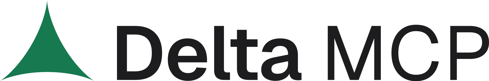
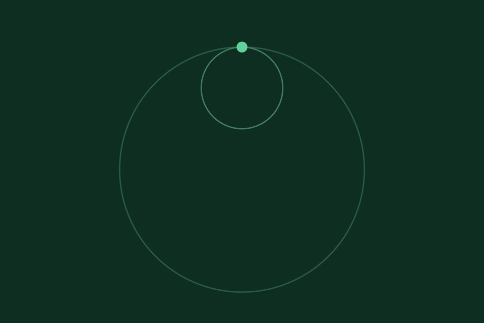
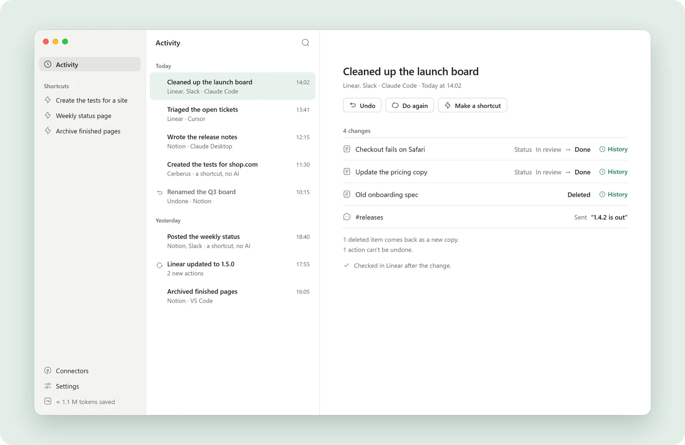
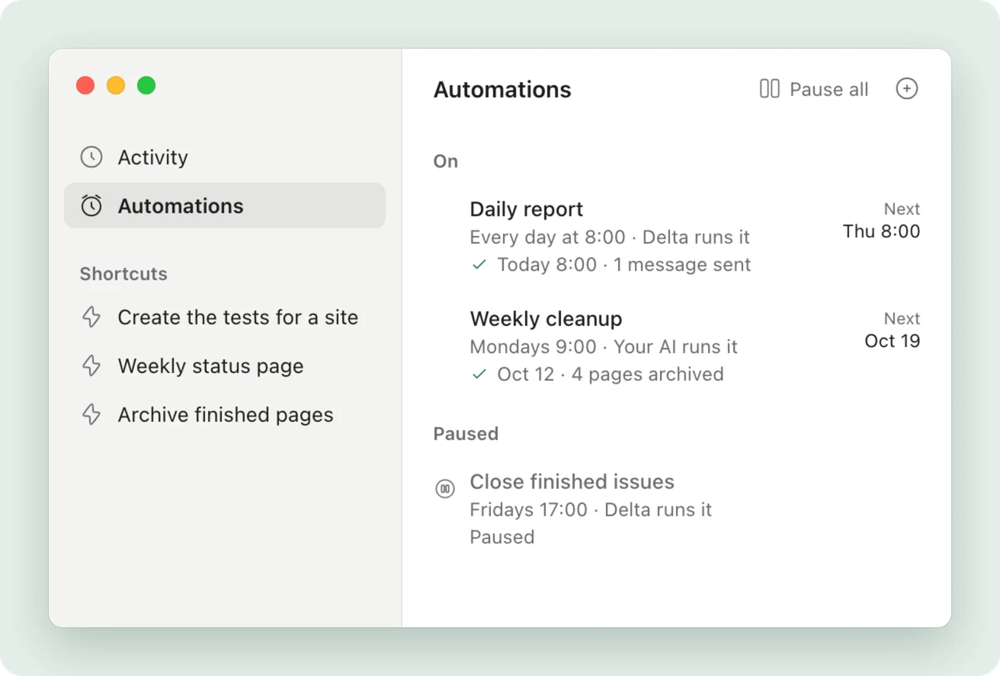
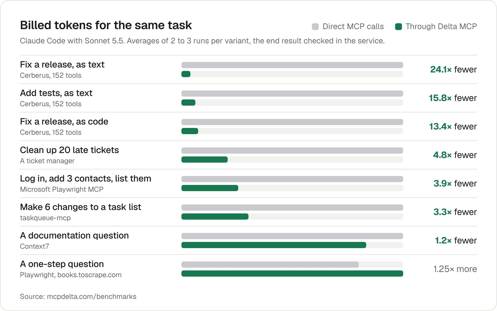
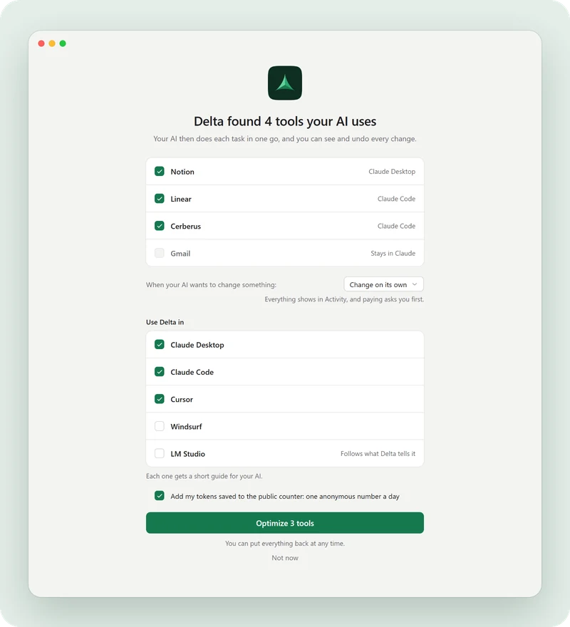

<picture>
  <source media="(prefers-color-scheme: dark)" srcset="assets/logo-dark.svg">
  
</picture>

<h1 align="center">Delta MCP: verifica y deshaz los cambios de tu IA</h1>

<strong>Delta MCP es una app gratuita entre tu IA y tus herramientas (Notion, GitHub, tus archivos…). Verifica cada tarea, hace todos los cambios o ninguno, y te deja deshacerla.</strong>

Cada cambio registrado, con Undo · Gratis, sin cuenta · Funciona en tu computadora

🌐 <a href="README.md">English</a> · <a href="README.zh.md">中文</a> · <a href="README.hi.md">हिन्दी</a> · <b>Español</b> · <a href="README.ar.md">العربية</a> · <a href="README.fr.md">Français</a> · <a href="README.bn.md">বাংলা</a> · <a href="README.pt.md">Português</a> · <a href="README.id.md">Bahasa Indonesia</a> · <a href="README.ur.md">اردو</a> · <a href="README.ru.md">Русский</a> · <a href="README.de.md">Deutsch</a> · <a href="README.it.md">Italiano</a> · <a href="README.nl.md">Nederlands</a> · <a href="README.el.md">Ελληνικά</a>

  <a href="https://www.mcpdelta.com/es">Sitio web</a> ·
  <a href="https://www.mcpdelta.com/es/how-it-works">Cómo funciona</a> ·
  <a href="https://www.mcpdelta.com/es/benchmarks">Benchmarks</a> ·
  <a href="https://www.mcpdelta.com/docs">Docs</a> ·
  <a href="https://www.mcpdelta.com/es/guides">Guías</a> ·
  <a href="https://www.mcpdelta.com/es/download">Descargar: próximamente</a>

> ⭐ **Apoya Delta MCP con una estrella.** Haz clic en **Star**, arriba a la derecha de esta página. Tarda un segundo, es gratis y ayuda a otras personas que usan MCP a encontrar Delta MCP antes del lanzamiento.

> **Próximamente** para macOS, Windows y Linux: gratis, sin cuenta. Sigue el lanzamiento y te enterarás en cuanto salga, sin dar tu correo: [RSS](https://www.mcpdelta.com/feed.xml), o **Watch → Custom → Releases** en este repositorio.

  

## Decide antes. Mira después. Deshaz.

1. **Tú decides antes.** Para cada herramienta, elige lo que tu IA puede hacer por su cuenta: solo leer, pedir confirmación antes de eliminar o enviar, o preguntar cada vez. Cuando pregunta, ves cada cambio, antes y después.
2. **Tú ves lo que pasó.** Cada cambio se registra con su antes y su después, escrito por Delta MCP y no por tu IA. Verifica el resultado en la herramienta cuando puede, y si se corta la conexión, verifica antes de repetir nada.
3. **Puedes deshacer.** Undo devuelve lo que se puede devolver, y te dice antes de hacer clic lo que no, como un mensaje que ya se envió.

  <picture>
    <source media="(prefers-color-scheme: dark)" srcset="assets/activity-dark.webp">
    
  </picture>

> ⭐ **¿Te gusta lo que ves? Una estrella es la forma más sencilla de apoyar Delta MCP.** Nos dice que merece la pena terminarlo.

## Ctrl+Z para el trabajo de tu IA.

Cada tarea muestra cada cambio antes y después. Deshazla enseguida, y en algunos casos más tarde, por ti o por tu IA.

- **Antes y después.** Cada cambio se muestra como era y como es ahora, leído de nuevo en el propio servicio cuando es posible.
- **Un paso o toda la tarea.** Tu IA escribe cómo deshacer cada paso. Si falla un paso posterior, o si haces clic en Undo, esas acciones de deshacer se ejecutan en orden inverso.
- **Honesto sobre lo que no vuelve atrás.** Antes de hacer clic, ves qué se restablecerá y qué no, como un mensaje que ya se envió. Delta MCP nunca dice que todo está deshecho sin pruebas.

## Automatiza las tareas que repites.

Configúralo una vez. Delta MCP lo ejecuta cada día, entre semana, cada lunes o cada hora, a un costo muy bajo, y tu IA solo interviene cuando la tarea requiere análisis.

- **Informes y rutinas.** Analiza los logs de Grafana de anoche y envía un informe a tu equipo. Sigue el mercado cada mañana. Cierra los tickets terminados cada viernes.
- **Gratis, o con tu IA.** Delta MCP la ejecuta gratis, sin IA. Si requiere análisis, tu IA toma la ejecución a la hora que elijas y luego informa, envía el correo o actúa según lo que encuentre.
- **Pide a tu IA que la cree.** Dile a tu IA qué automatizar: la crea en Delta MCP. Tú la pruebas, firmas una sola vez y, tras dos fallos, se pone en pausa y te avisa.

  <picture>
    <source media="(prefers-color-scheme: dark)" srcset="assets/automations-dark.webp">
    
  </picture>

## Medido: hasta 24,1× menos tokens

Mismo resultado, muchos menos tokens. En tareas de varios pasos, Delta MCP usa menos tokens, cuesta menos y termina igual de rápido o más rápido, con el mismo resultado final, verificado en el propio servicio. 8 escenarios, cada uno ejecutado con y sin Delta MCP, en Claude Code con Sonnet 5.5. Una pregunta suelta de un solo paso cuesta más: la ganancia está en las tareas de varios pasos.

| 3,3–24,1× | 1,4–8,1× | hasta 4,4× | 100% |
|:--|:--|:--|:--|
| menos tokens facturados en tareas de varios pasos | menor costo en tareas de varios pasos, incluso en el caso de caché más exigente | más rápido en tareas de varios pasos, y ningún escenario es más lento | de las herramientas conservadas: cada herramienta original se puede llamar por su nombre a través de Delta MCP |

  <picture>
    <source media="(prefers-color-scheme: dark)" srcset="assets/bench-dark.png">
    
  </picture>

**[Todos los benchmarks, con el método →](https://www.mcpdelta.com/es/benchmarks)**

## Funciona con 12 apps de IA

Claude Desktop, Claude Code, Cursor, VS Code, Windsurf, Gemini CLI, Cline, Roo Code, LM Studio, Amazon Q, Codex y Zed. Las diez primeras las pasa a Delta MCP por ti; Codex y Zed se configuran a mano por ahora. Tus servidores MCP se quedan exactamente como están. [Cómo se pasa cada app a Delta MCP](https://www.mcpdelta.com/docs/supported-apps).

## Descargar: próximamente

La app gratuita para macOS, Windows y Linux llega pronto. Todavía no hay nada que instalar, y este repositorio no contiene la app.

| Opción | Dónde |
|:--|:--|
| **Página de descarga** | [mcpdelta.com/es/download](https://www.mcpdelta.com/es/download) |
| **Seguir con RSS** | [mcpdelta.com/feed.xml](https://www.mcpdelta.com/feed.xml) |
| **Seguir las versiones aquí** | **Watch → Custom → Releases**, en este repositorio |

### Listo en dos minutos

1. **Descarga y abre Delta MCP.** Gratis, para Mac, Windows y Linux.
2. **Encuentra las herramientas que usa tu IA.** Sus servidores MCP, en Claude Desktop, Claude Code, Cursor, VS Code y 8 apps más, verificados en directo.
3. **Haz clic en Optimize.** A partir de ahí, tu IA los usa a través de Delta MCP. Deja todo como estaba cuando quieras.

  <picture>
    <source media="(prefers-color-scheme: dark)" srcset="assets/first-launch-dark.webp">
    
  </picture>

## Guías de MCP

Respuestas directas sobre MCP: deshacer los cambios de una IA, acceso seguro, timeouts, costos y tus apps de IA, cada una con sus fuentes.

- [Cómo deshacer los cambios de IA en Notion, GitHub y archivos](https://www.mcpdelta.com/es/guides/undo-ai-agent-changes)
- [¿Un agente de IA borró o cambió datos? Qué hacer primero](https://www.mcpdelta.com/es/guides/ai-agent-costly-change)
- [Cómo dar a una IA acceso a tus herramientas con seguridad](https://www.mcpdelta.com/es/guides/safe-ai-access-mcp)
- [Timeout en MCP: mira si el cambio se hizo antes de repetir](https://www.mcpdelta.com/es/guides/mcp-write-timeout)
- [Puerta de enlace MCP, proxy o Delta MCP: ¿cuál necesitas?](https://www.mcpdelta.com/es/guides/mcp-gateway-vs-proxy)
- [Cuándo usar MCP, y cuándo copiar y pegar es más rápido](https://www.mcpdelta.com/es/guides/when-to-use-mcp)
- [Cómo reducir el consumo de tokens de MCP y por qué es alto](https://www.mcpdelta.com/es/guides/reduce-mcp-token-usage)
- [Límite de uso de Claude Code: qué cuestan tus servidores MCP](https://www.mcpdelta.com/es/guides/claude-code-usage-limit-mcp)
- [Archivo de configuración MCP: Claude, Cursor, VS Code y más](https://www.mcpdelta.com/es/guides/mcp-clients)
- [MCP vs CLI para agentes de IA: el origen del costo en tokens](https://www.mcpdelta.com/es/guides/mcp-vs-cli)

## Preguntas sobre Delta MCP

<strong>¿Qué es Delta MCP?</strong>

Delta MCP es una app gratuita que se sitúa entre tus apps de IA (Claude, Cursor, VS Code…) y las herramientas que usan, como Notion, GitHub o tus archivos. Verifica cada tarea antes de ejecutarla, hace todos los cambios o ninguno, guarda un registro de cada cambio y te deja deshacer lo que se puede deshacer. Técnicamente, tu IA escribe cada tarea como un solo programa; Delta MCP lo verifica antes de la primera llamada, lo aplica todo o nada, vuelve a leer el resultado y habla con tus servidores MCP tal como son, con muchos menos tokens en las tareas de varios pasos.

<strong>¿Qué es MCP?</strong>

MCP (Model Context Protocol) es el estándar que permite a las apps de IA como Claude, Cursor o VS Code usar otras apps y servicios, como Notion o GitHub. Cada servicio ofrece sus herramientas a través de un servidor MCP, también llamado conector. Delta MCP se sitúa entre tu IA y esos servidores; no necesitas saber más que eso para usarlo.

<strong>¿Delta MCP es de verdad gratis?</strong>

Sí. Todas las funciones están en la app gratuita, sin cuenta y sin límite de servidores. Consulta los [precios](https://www.mcpdelta.com/es/pricing).

<strong>¿Necesito saber programar para usar Delta MCP?</strong>

No. Se lo pides a tu IA como siempre; ella escribe el programa y Activity muestra cada cambio en palabras sencillas, con Undo.

<strong>¿Qué pasa si una tarea falla a mitad de camino?</strong>

Los cambios hechos a elementos como un estado, una etiqueta o una página se devuelven a su estado anterior y se verifican, para que no quede nada a medias. Un paso que ya hizo una herramienta tal cual queda hecho, y Delta MCP lo deja anotado para que tu IA no lo repita. Si una respuesta se pierde por el camino, Delta MCP verifica, cuando puede, si el cambio llegó a ocurrir antes de rehacer nada, y un mensaje nunca se reenvía por sí solo. Undo devuelve a su estado lo que puede devolverse y dice lo que no, como un mensaje que ya se envió.

<strong>Mi app de IA ya pregunta antes de actuar. ¿Qué añade Delta MCP?</strong>

Si quieres dar tu aprobación antes, la tarjeta de Delta MCP muestra qué va a cambiar, antes y después, en lugar de solo nombrar la herramienta que se va a ejecutar. Después hace todos los cambios o ninguno, verifica el resultado y mantiene un Undo. Tú eliges, para cada herramienta, qué necesita tu aprobación y qué puede hacer tu IA por su cuenta.

<strong>¿Delta MCP ahorra tokens?</strong>

Sí, en tareas con varios pasos: de 3,3 a 24,1 veces menos tokens en nuestras mediciones. Una pregunta suelta de un solo paso cuesta más (cerca de 1,25 veces los tokens), porque tu IA lee la breve descripción de Delta MCP en cada llamada.

<strong>¿Tengo que modificar mis servidores MCP?</strong>

No. Delta MCP los usa exactamente como están. Cada herramienta original se puede llamar por su nombre: 152 de 152 en el servidor más grande que probamos.

<strong>¿Delta MCP envía mis datos a otra parte?</strong>

No. Delta MCP se ejecuta en tu computadora y habla directamente con tus servidores; tus herramientas, tareas e historial nunca salen de ella. Además de una consulta para ver si hay versiones nuevas, que no envía nada sobre ti, lo único que puede enviarse es un número anónimo al día, tus tokens ahorrados: tú eliges en el primer inicio, y se desactiva en Settings con un clic.

<strong>¿Delta MCP es de código abierto?</strong>

No. Delta MCP es una app gratuita y su código fuente no es público. Cómo funciona está explicado en la documentación, cómo se mide está en la página de benchmarks, y todo lo que hace en tu computadora queda registrado en Activity.

<strong>¿Cómo dejo de usar Delta MCP?</strong>

En Settings, elige Put everything back (dejar todo como estaba). Cada conector vuelve a tus apps de IA exactamente como estaba; Delta MCP guarda una copia de cada archivo que cambió.

<strong>¿Con qué apps de IA funciona Delta MCP?</strong>

Delta MCP funciona con 12 apps de IA: Claude Desktop, Claude Code, Cursor, VS Code, Windsurf, Gemini CLI, Cline, Roo Code, LM Studio, Amazon Q, Codex y Zed. Las diez primeras las pasa a Delta MCP por ti; Codex y Zed se configuran a mano por ahora.

<strong>¿Sigo necesitando Delta MCP si mi app de IA tiene Tool Search?</strong>

Sí, en tareas con varios pasos. Tool Search mantiene corta la lista de herramientas, pero cada paso sigue siendo una solicitud aparte al modelo. Delta MCP elimina esas solicitudes: tu IA escribe la tarea como un solo programa. Nuestras mediciones se hicieron con Tool Search activado, así que el ahorro se suma al suyo.

<strong>¿Delta MCP es una puerta de enlace o un proxy MCP?</strong>

Se coloca donde se coloca una puerta de enlace: una sola entrada en tus apps de IA, frente a todos tus servidores MCP, para que tu IA no cargue cada herramienta de cada servidor. Funciona en tu propia computadora, gratis y sin ningún servicio que mantener, así que se parece más a un proxy local que a una puerta de enlace empresarial. Lo que añade es lo que una puerta de enlace simple no hace: tu IA escribe cada tarea como un solo programa tipado, Delta MCP lo verifica antes de la primera llamada, lo aplica todo o nada, lo vuelve a leer, lo guarda en Activity con Undo y puede guardarlo como atajo o ejecutarlo a una hora fija.

<strong>¿Qué puedo automatizar con Delta MCP?</strong>

Cualquier tarea que repitas: leer los logs de Grafana de anoche y enviar un informe a tu equipo, seguir el mercado y enviar un resumen diario, cerrar los tickets terminados cada viernes. Eliges cuándo se ejecuta: cada día, entre semana, cada lunes o cada hora. Cada ejecución aparece en Activity, y la barra de menús muestra la próxima ejecución y la última.

<strong>¿Una automatización necesita tu IA?</strong>

No siempre. Delta MCP puede ejecutarla por sí mismo, gratis, sin IA y sin tokens. Cuando la tarea requiere análisis, se la pasa a tu IA a la hora que elijas: una breve sesión de IA que redacta el informe, envía el correo o actúa según los resultados, con tu app de IA abierta o con una IA de línea de comandos, como Claude Code, instalada.

<strong>¿Puede tu IA crear una automatización por mí?</strong>

Sí. Dile a tu IA qué automatizar: la crea en Delta MCP. La pruebas primero y, después, firmas una sola vez. Tras dos fallos, se pone en pausa y te avisa. Una automatización solo puede enviar lo que firmaste, indicado en su tarjeta.

## ⭐ Apoya Delta MCP con una estrella

Delta MCP es gratis y está pensado para ganarse tu confianza. Si suena a lo que necesitas, dale una estrella a este repositorio: es la forma más sencilla de apoyarlo, ayuda a otras personas a encontrarlo y te permitirá volver a él cuando salga. Gracias.

## Delta MCP en tu idioma

Cada idioma tiene su propio README y su propio sitio web.

<a href="README.md">English</a> · <a href="README.zh.md">中文</a> · <a href="README.hi.md">हिन्दी</a> · <b>Español</b> · <a href="README.ar.md">العربية</a> · <a href="README.fr.md">Français</a> · <a href="README.bn.md">বাংলা</a> · <a href="README.pt.md">Português</a> · <a href="README.id.md">Bahasa Indonesia</a> · <a href="README.ur.md">اردو</a> · <a href="README.ru.md">Русский</a> · <a href="README.de.md">Deutsch</a> · <a href="README.it.md">Italiano</a> · <a href="README.nl.md">Nederlands</a> · <a href="README.el.md">Ελληνικά</a>

## Seguridad

Para informar de un problema, escríbenos en privado a [contact@mcpdelta.com](mailto:contact@mcpdelta.com). Consulta [SECURITY.md](SECURITY.md).

## Licencia

Delta MCP es software propietario y no es de código abierto. Este repositorio solo presenta la app: no contiene código fuente. Consulta [NOTICE](NOTICE).

---

© 2026 Delta MCP. Todos los derechos reservados. Este repositorio solo presenta la app.

